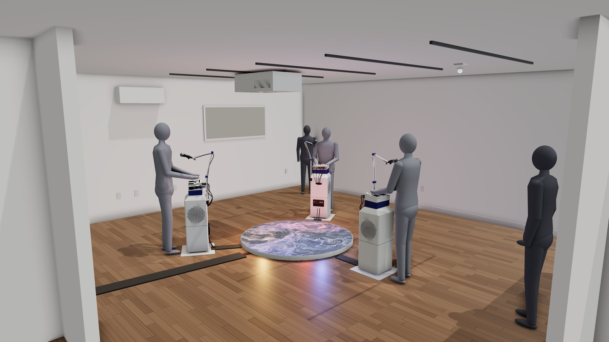
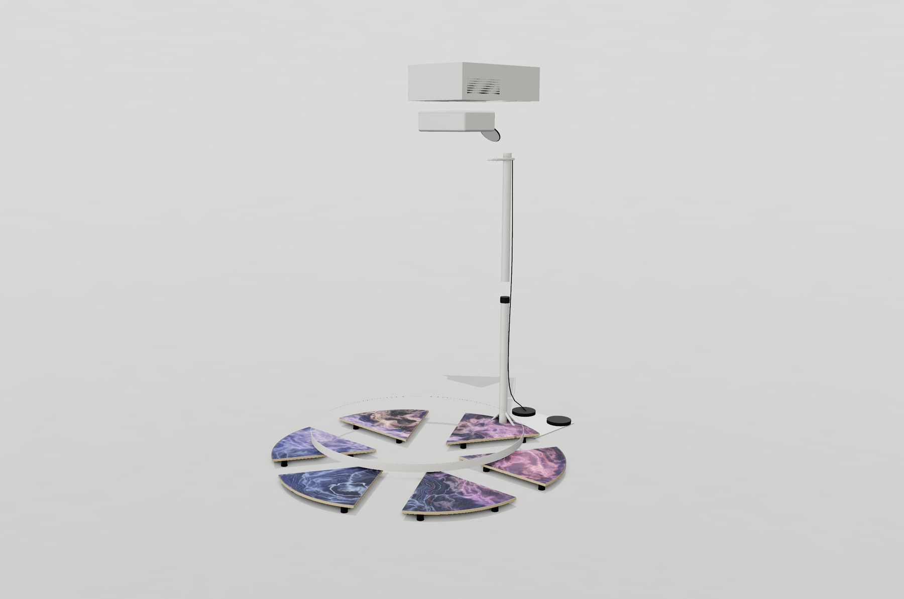

# IMPRESSION[S]

**Maquette 3D en ligne : https://filliformes.github.io/impressions/**

Installation audiovisuelle de **Vincent Fillion**. Trois instruments (RES, PHASMA, ESSAIM) sont disposés à distance égale autour d'un disque d'image. Ils s'écoutent et se parlent sur un réseau fermé. L'image vient de [Palinopsia](https://github.com/filliformes/palinopsia), en régie. Présentation prévue à la galerie EISODE (Artificiel, Montréal), du 3 au 6 juin 2027.

## Un instrument

Chaque instrument tourne sur [Pandore](https://github.com/filliformes/pandore) et s'empile ainsi :

1. le **PCB FLOU** et ses contrôles (6 potentiomètres, 2 pads XY, 3 boutons, 1 slider, écran et encodeur)
2. le **case** en métal blanc, qui contient Pandore et FLOU
3. la **base molle** en silicone aimanté : l'instrument bouge et revient en place, ce qui permet de jouer de l'IMU sans le sortir de son stand
4. le **stand**, avec deux haut-parleurs de 10 po dos à dos (gauche et droite) et leur ampli
5. un **micro** dynamique, sur pied ou sur bras articulé

| | Idée | Emprise au sol |
|---|---|---|
| **A Monolithe** | Bloc de tôle pliée, épaulement à 45° repris du capot, perforations reprises du case | 460 × 460 mm |
| **B Losange** | Volume à facettes, large aux haut-parleurs, resserré en haut et en bas | 470 × 450 mm |

## L'écran

Un disque horizontal, un seul projecteur, une structure démontable. Trois systèmes sont dans la maquette.

| Système | Image | Projecteur | Principe |
|---|---|---|---|
| **Table rétroprojetée** | 5,5 pi (1,68 m) | ViewSonic LS560WH (LED) | Anneau en six arcs, toile tendue, six pieds. Le projecteur et un miroir sont sur un banc pliant, sous la toile |
| **Plateforme, rail ou mât** | 5,5 pi à EISODE | BenQ LK953ST (liste de prêt) | Plateforme en six segments. Le caisson s'accroche au rail 80/20 du plafond, ou au bout d'un mât portatif posé au bord du disque |
| **Plateforme et portique** | selon le projecteur | au choix | Trois pieds entre les instruments, projecteur au centre |

## EISODE

La galerie est modélisée d'après son plan coté : 8,06 × 9,27 m, plafond à 2,57 m, cinq rails 80/20, fenêtres, prises et connecteurs Cat 6. Les ouvertures doivent être occultées pendant l'exposition.

## La maquette

- **Espace** : la galerie, les instruments, le public et la régie. Vues d'ensemble, du joueur, en coupe, en maquette et de dessus. La position du disque, la lumière et l'écart se règlent.
- **Instrument** : les deux stands, les deux porte-micros, vue éclatée, intérieur, cotes, export GLB (Rhino 8, Blender). On peut glisser l'instrument pour l'incliner sur sa base molle.
- **Écran** : le système choisi seul, avec vue éclatée, coupe, cotes et export GLB.
- **Fabrication** : liste des pièces, colis, montage, tolérances, coupe cotée et fichiers DXF et CSV, calculés à partir des réglages.
- **Plan et cotes**, **Signal**, **À trancher**.

Les réglages sont dans l'adresse de la page : copier le lien partage la configuration.

## Crédits

Œuvre et conception : Vincent Fillion. Design du case, du PCB FLOU et de la base molle : François Auclair (Atelier FA). Pandore : Vincent Fillion, avec Alexandre Burton et Laurence Deschênes Villeneuve.

Le case est remodelé d'après les cotes des fichiers de François. La hauteur de la base molle, le contour du PCB FLOU, les masses et l'image projetée sont provisoires. Les cotes de fabrication sont à valider par la personne qui fabrique.
