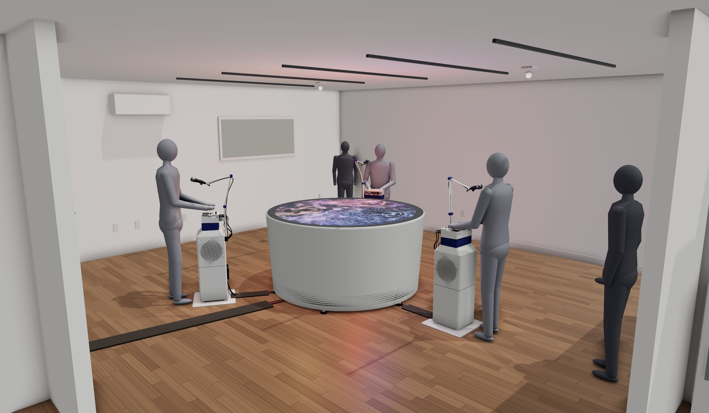
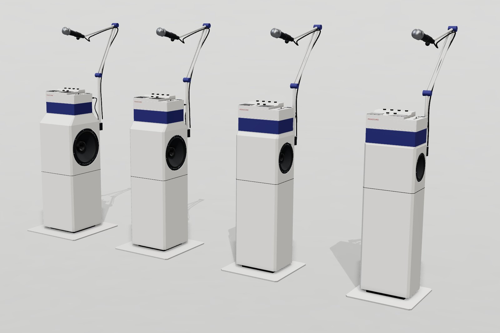
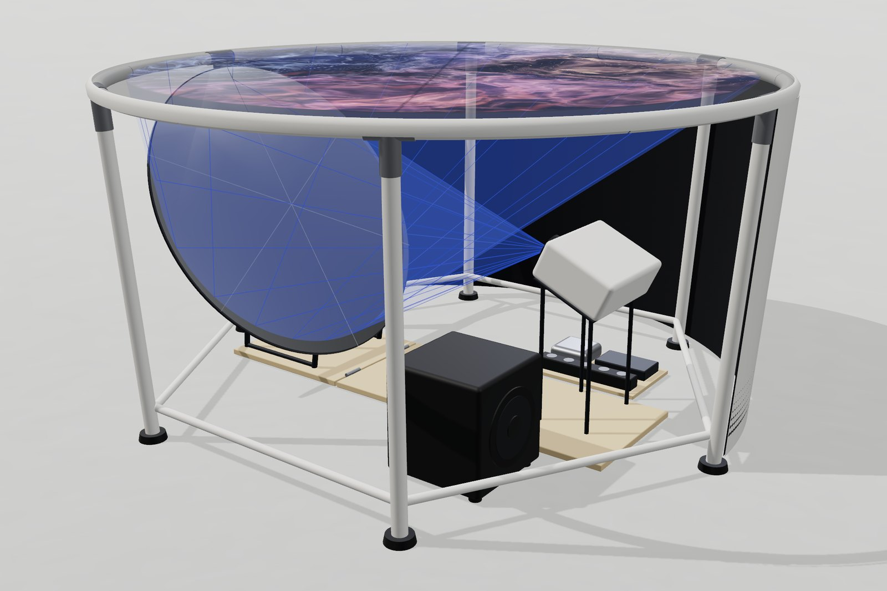
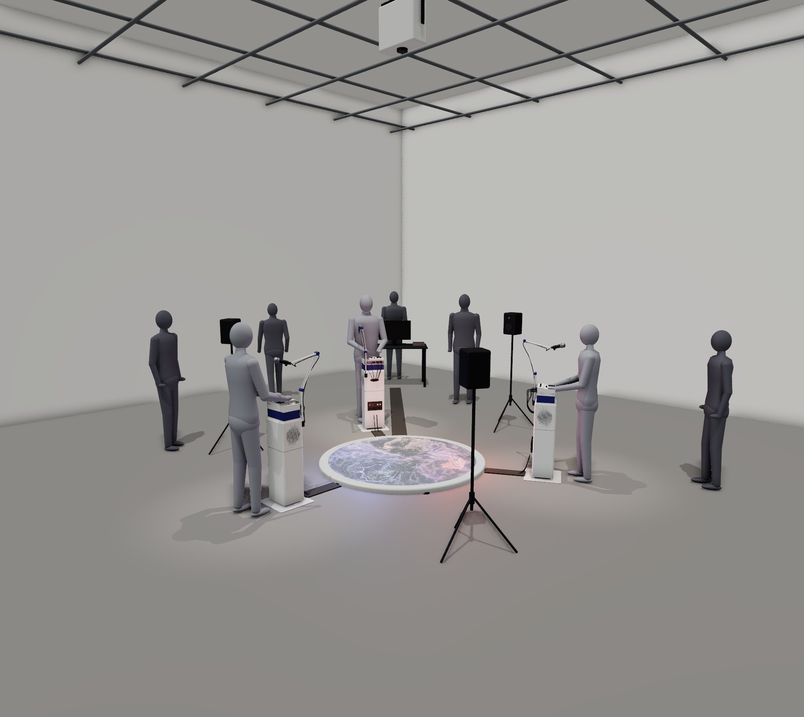
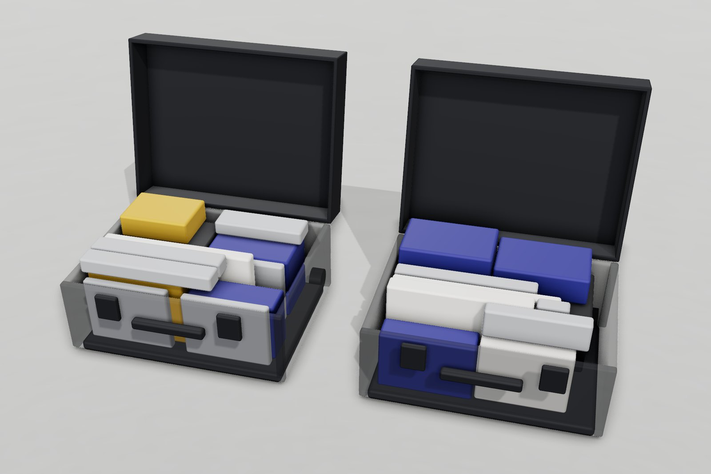

# IMPRESSION[S]

**Maquette 3D en ligne : https://filliformes.github.io/impressions/**

Installation audiovisuelle de **Vincent Fillion**. Trois instruments (RES, PHASMA, ESSAIM) sont disposés à distance égale autour d'un disque d'image. Ils s'écoutent et se parlent sur un réseau fermé. L'image vient de [Palinopsia](https://github.com/filliformes/palinopsia). Présentation prévue à la galerie EISODE (Artificiel, Montréal), du 3 au 6 juin 2027.

## Un instrument

Chaque instrument tourne sur [Pandore](https://github.com/filliformes/pandore) et s'empile ainsi :

1. le **PCB FLOU** et ses contrôles (6 potentiomètres, 2 pads XY, 3 boutons, 1 slider, écran et encodeur)
2. le **case** en métal blanc, qui contient Pandore et FLOU ; son côté droit est plein et rigide
3. la **base molle** en silicone aimanté : l'instrument bouge et revient en place, ce qui permet de jouer de l'IMU sans le sortir de son stand
4. le **stand** (Monolithe ou Losange), avec deux haut-parleurs dos à dos (gauche et droite) et leur ampli
5. un **micro** dynamique, sur pied ou sur bras articulé

Les haut-parleurs se choisissent entre 10, 8, 6,5 et 5 po. Tout le stand suit.

## L'écran

Un disque horizontal, un seul projecteur, une structure démontable. Le **dessus** (anneau en douze arcs, six nœuds, toile) est le même dans tous les systèmes. Il se détache de la table et sert seul.

| Système | Toile | Projecteur | Principe |
|---|---|---|---|
| **Table rétroprojetée** | grise | ViewSonic LS560WH (LED) | Six grands pieds. Le projecteur et un disque de papier miroir, en secteurs, sont sur un banc pliant sous la toile |
| **Par-dessus, EISODE** | blanche | BenQ LK953ST (liste de prêt) | Pieds courts. Le caisson s'accroche au rail 80/20 du plafond, ou au bout d'un mât portatif |
| **Dessus seul, gril** | blanche | celui du lieu | Pieds courts, projecteur au gril. Pour les lieux équipés (idée de Myriam) |
| **Portique** | blanche | au choix | Trois pieds entre les instruments, projecteur au centre |

La hauteur de l'écran se règle. Un sub de 8 po et l'ordinateur des visuels peuvent aller sous la toile, hors du faisceau.

## Transport

L'onglet Transport range l'œuvre dans des cases Pelican, avec les masses et les limites de la soute.

## EISODE

La galerie est modélisée d'après son plan coté : 8,06 × 9,27 m, plafond à 2,57 m, cinq rails 80/20, fenêtres, prises et connecteurs Cat 6, coin cuisine à droite de l'entrée. Les ouvertures doivent être occultées pendant l'exposition.

## La maquette

- **Espace** : la galerie ou un lieu avec gril, les instruments, le public et la régie. Vues d'ensemble, du joueur, en coupe, en maquette et de dessus.
- **Instrument** : les stands, les tailles de haut-parleurs, les porte-micros, vue éclatée, intérieur, cotes, export GLB (Rhino 8, Blender). On peut glisser l'instrument pour l'incliner sur sa base molle.
- **Écran** : le système choisi seul, avec vue éclatée, coupe, cotes et export GLB.
- **Fabrication** : liste des pièces, montage, tolérances, coupe cotée et fichiers DXF et CSV, calculés à partir des réglages.
- **Transport** : ce qui entre dans combien de cases, et à quel poids.
- **Plan et cotes**, **Signal**, **À trancher**.

Les réglages sont dans l'adresse de la page : copier le lien partage la configuration.

## Crédits

Œuvre et conception : Vincent Fillion. Design du case, du PCB FLOU et de la base molle : François Auclair (Atelier FA). Pandore : Vincent Fillion, avec Alexandre Burton et Laurence Deschênes Villeneuve.

Le case est remodelé d'après les cotes des fichiers de François. La hauteur de la base molle, le contour du PCB FLOU, les masses, la texture du papier miroir et l'image projetée sont provisoires. Les cotes de fabrication sont à valider par la personne qui fabrique.
