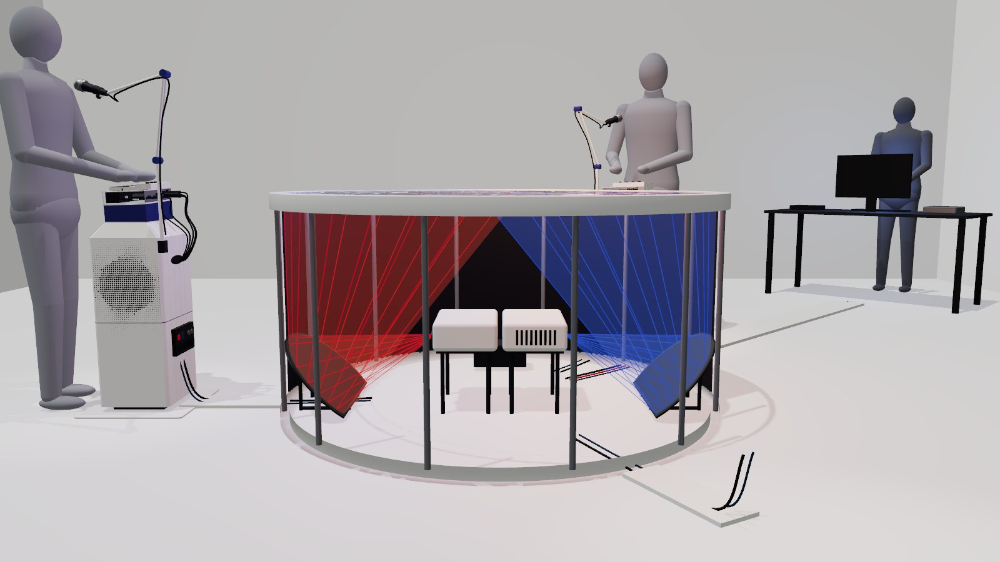

# IMPRESSION[S]

**Maquette 3D en ligne : https://filliformes.github.io/impressions/**

Installation audiovisuelle de **Vincent Fillion**. Trois instruments (RES, PHASMA, ESSAIM) sont disposés à distance égale autour d'un cercle de rétroprojection. Ils s'écoutent et se parlent sur un réseau fermé. L'image vient de [Palinopsia](https://github.com/filliformes/palinopsia), en régie.

## Un instrument

Chaque instrument tourne sur [Pandore](https://github.com/filliformes/pandore) et s'empile ainsi :

1. le **PCB FLOU** et ses contrôles (6 potentiomètres, 2 pads XY, 3 boutons, 1 slider, écran et encodeur)
2. le **case** en métal blanc, qui contient Pandore et FLOU
3. la **base molle** en silicone aimanté : l'instrument bouge et revient en place, ce qui permet de jouer de l'IMU sans le sortir de son stand
4. le **stand**, avec deux haut-parleurs de 10 po dos à dos (gauche et droite) et leur ampli
5. un **micro** dynamique, sur pied ou sur bras articulé

| | Idée | Emprise au sol |
|---|---|---|
| **A Monolithe** | Bloc de tôle pliée, épaulement à 45° repris du capot, perforations reprises du case | 460 × 460 mm |
| **B Losange** | Volume à facettes, large aux haut-parleurs, resserré en haut et en bas | 470 × 450 mm |

## L'espace

Une galerie blanche. Un disque horizontal de 6 pi (1,83 m), rétroprojeté par en dessous, dans un socle rond en tôle blanche de 1,96 m. Deux petits projecteurs à plat, dos à dos au centre, tirent chacun vers un miroir à 45° et éclairent un demi-disque. La maquette cherche le plus petit socle sans ombre portée.

## La maquette

- **Espace** : vues d'ensemble, du joueur, de la régie, coupe et dessus. Diamètre, hauteur, écarts et salle sont réglables.
- **Instrument** : les deux stands, les deux porte-micros, vue éclatée, intérieur, cotes, export GLB (Rhino 8, Blender). On peut glisser l'instrument pour l'incliner sur sa base molle.
- **Plan et cotes** : plan de l'espace et élévations, générés à partir des réglages.
- **Signal** : chaîne audio, données et image.
- **À trancher** : les questions de conception ouvertes.

Les réglages sont dans l'adresse de la page : copier le lien partage la configuration.

## Crédits

Œuvre et conception : Vincent Fillion. Design du case, du PCB FLOU et de la base molle : François Auclair (Atelier FA). Pandore : Vincent Fillion, avec Alexandre Burton et Laurence Deschênes Villeneuve.

Le case est remodelé d'après les cotes des fichiers de François. La hauteur de la base molle, le contour du PCB FLOU et l'image projetée sont provisoires.
