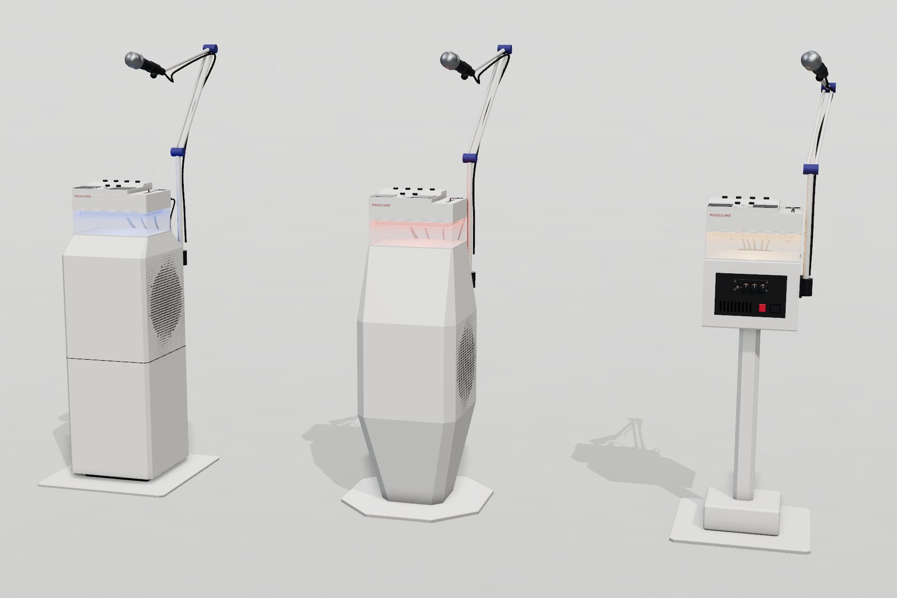
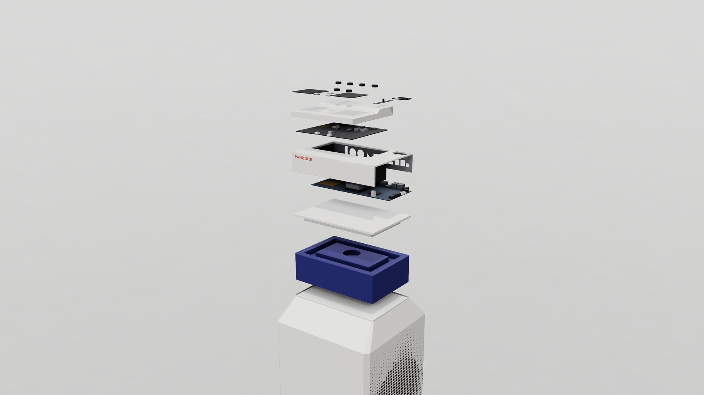
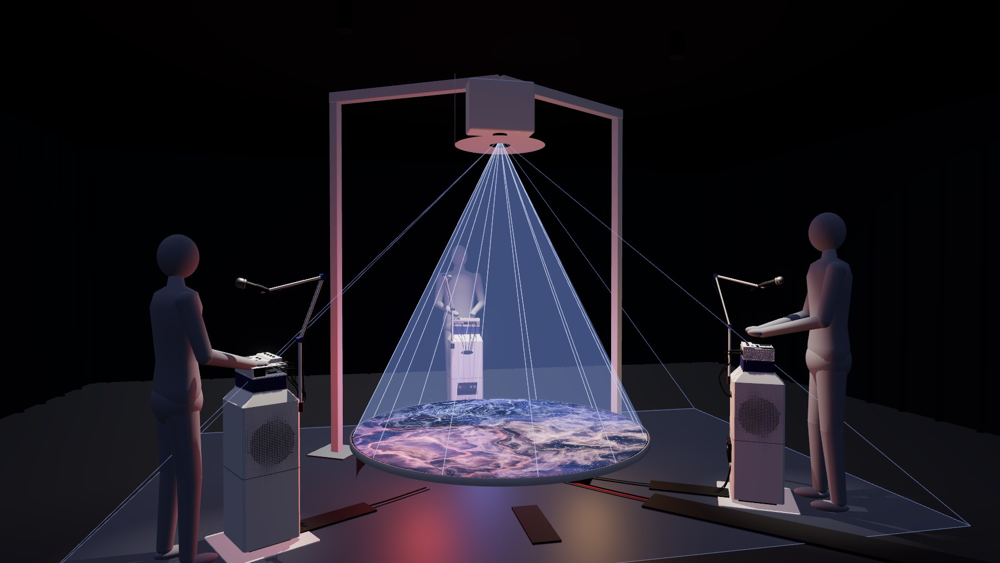

# IMPRESSION[S]

**Maquette 3D en ligne : https://filliformes.github.io/impressions/**

Installation audiovisuelle de **Vincent Fillion**. Trois instruments (RES, PHASMA, ESSAIM) sont disposés à distance égale autour d'un cercle de rétroprojection. Ils s'écoutent et se parlent sur un réseau fermé. L'image vient de [Palinopsia](https://github.com/filliformes/palinopsia), en régie.

## Un instrument

Chaque instrument tourne sur [Pandore](https://github.com/filliformes/pandore) et s'empile ainsi :

1. le **PCB FLOU** et ses contrôles (6 potentiomètres, 2 pads XY, 3 boutons, 1 slider, écran et encodeur)
2. le **case** en métal blanc, qui contient Pandore et FLOU
3. la **base molle** en silicone aimanté : l'instrument bouge et revient en place, ce qui permet de jouer de l'IMU sans le sortir de son stand
4. le **stand**, avec deux haut-parleurs de 10 po dos à dos (gauche et droite) et leur ampli
5. un **micro** dynamique, sur pied ou sur bras articulé

| | Idée | Emprise au sol |
|---|---|---|
| **A Monolithe** | Bloc de tôle pliée, épaulement à 45° repris du capot, perforations reprises du case | 460 × 460 mm |
| **B Losange** | Volume à facettes, large aux haut-parleurs, resserré en haut et en bas | 470 × 450 mm |
| **C Portique** | Deux tôles et un caisson suspendu, câblage visible | 420 × 400 mm |

## L'espace

Le cercle fait de 6 à 8 pi, sous un plafond de 10 pi. Quatre versions sont modélisées : disque horizontal avec un projecteur fisheye au centre, disque avec deux projecteurs ultra-courts, cylindre 360° avec miroir convexe, et plateforme basse projetée par le haut. L'onglet Espace calcule l'optique requise.

### Par le haut

Une plateforme basse (300 mm par défaut, de 0 à 600 mm), peinte en blanc mat, reçoit l'image. Le projecteur est dans le caisson d'un portique à trois pieds, placés entre les instruments, avec le dessus à 18 cm du plafond. Il pointe vers le bas, ou il est couché avec un miroir à 45°.

Sous 10 pi, la profondeur d'un projecteur pointé vers le bas se prend sur la hauteur : il reste environ 2 m jusqu'à la plateforme. Pour qu'un cercle de 7 pi tienne dans le petit côté d'une image 16:10, il faut un rapport de projection d'environ 0,6 : 1. Les courtes focales courantes (0,8 : 1) n'y arrivent pas. Le miroir allonge le trajet de 0,5 à 0,6 m.

Cercle de 7 pi sur une plateforme de 300 mm :

| Projecteur | Rapport | Pointé vers le bas | Couché, miroir à 45° | Prix ≈ ($ US) |
|---|---|---|---|---|
| BenQ LU960ST2 (1 DLP, 5 200 lm) | 0,5 : 1 | jusqu'à 8,4 pi, 968 px sur le cercle | jusqu'à 10,5 pi, 780 px | 7 100 à 9 000 |
| Epson EB-PU1007W + ELPLU03S (3LCD, 7 000 lm) | 0,65 à 0,78 : 1 | 6,1 pi au plus | jusqu'à 8,0 pi, 1 165 px | 9 000 à 14 000 avec l'objectif |
| Optoma ZU920TST (1 DLP, 9 800 lm) | 0,65 à 0,75 : 1 | 6,3 pi au plus | jusqu'à 8,0 pi, 1 165 px | ≈ 10 000 |
| Epson EB-L690SU (3LCD, 6 200 lm), pour comparer | 0,79 à 1,36 : 1 | 5,4 pi au plus | 6,7 pi au plus | ≈ 4 700 |

Les chiffres viennent des pages des fabricants citées dans l'onglet À trancher, relevés le 25 novembre 2026 sans visite directe des pages : à confirmer auprès du fournisseur avant achat. Le tableau de l'onglet À trancher suit les réglages de l'onglet Espace.

## La maquette

- **Espace** : vues d'ensemble, du joueur, de la régie, coupe et dessus. Diamètre, hauteur, écarts et salle sont réglables. En version « par le haut », on choisit aussi le projecteur et son montage.
- **Instrument** : les trois stands, les deux porte-micros, vue éclatée, intérieur, cotes, export GLB (Rhino 8, Blender). On peut glisser l'instrument pour l'incliner sur sa base molle.
- **Plan et cotes** : plan de l'espace et élévations, générés à partir des réglages.
- **Signal** : chaîne audio, données et image.
- **À trancher** : les questions de conception ouvertes.

Les réglages sont dans l'adresse de la page : copier le lien partage la configuration.

## Crédits

Œuvre et conception : Vincent Fillion. Design du case, du PCB FLOU et de la base molle : François Auclair (Atelier FA). Pandore : Vincent Fillion, avec Alexandre Burton et Laurence Deschênes Villeneuve.

Le case est remodelé d'après les cotes des fichiers de François. La hauteur de la base molle, le contour du PCB FLOU et l'image projetée sont provisoires.
